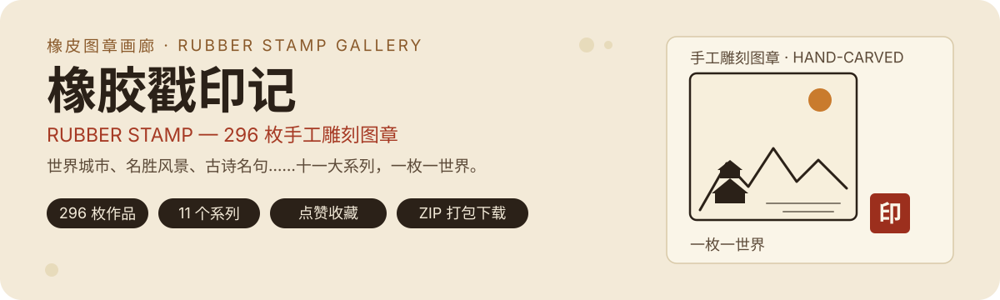
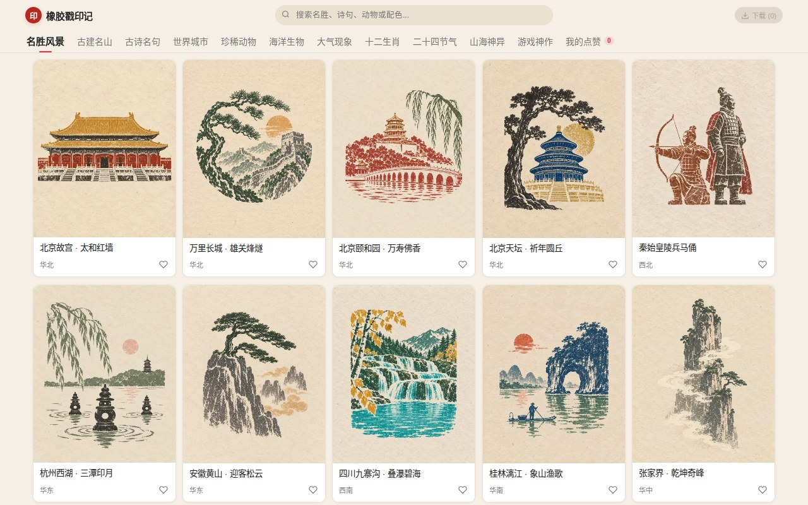

<p align="right"><a href="README.md">中文</a></p>

<p align="center">
  
</p>

<p align="center">
  <a href="https://xiaosang.cc/rubber-stamp-world-cities/">▶ View Online</a>
  ·
  <a href="https://holynova.github.io/rubber-stamp/">GitHub Pages Mirror</a>
  ·
  <a href="https://github.com/holynova/rubber-stamp">GitHub Repository</a>
</p>

Rubber Stamp is a gallery of hand-carved multi-color rubber stamp art: 296 works in 11 series. Each piece strips away text and layout noise, keeping only the carved stamp and warm fibrous paper — world cities, scenic spots, classical poetry, zodiac animals, solar terms, and mythical beasts from the Classic of Mountains and Seas. One stamp, one world.

> **Branch note**: this README describes the default branch `main` (296 works). `main` and `master` (350 works) have diverged; the live site serves `master` (adds Chinese cities ×30, seasonal festivals ×20, and popular destinations ×24; drops heritage architecture & famous mountains ×20), so the live gallery's series and counts differ slightly from this branch. The repository was renamed from `rubber-stamp-world-cities` to `rubber-stamp`; the old Pages URL now 404s — use the new one.

## Screenshots

<p align="center">
  
</p>

> Screenshot taken locally from the current `main` branch. The root-level `screenshot.png` and `screenshot_journal.png` are screenshots of an older version (the latter shows 236 works) and are kept as-is.

## Collections

| # | Series | Count | Contents |
|---|------|------|------|
| 1 | 名胜风景 (Scenic Spots) | 50 | China's 50 top 5A-rated scenic spots and World Heritage sites (Forbidden City, Great Wall, Summer Palace, Temple of Heaven, Terracotta Army, West Lake, Mount Huang, Jiuzhaigou …), grouped into seven geographic regions: North, East, Southwest, Northwest, Central, South, and Northeast China |
| 2 | 古诗名句 (Classical Poetry Lines) | 50 | 50 highly visual lines from classical Chinese poetry, in five volumes — 春生·花木 (Spring: Flowers & Trees), 夏盛·清荷 (Summer: Lotus), 秋思·枫江 (Autumn: Maples & Rivers), 冬藏·飞雪 (Winter: Snow), 天地·旷野 (Heaven & Earth: Open Wilds); each stamp is inscribed with the line, its source, and its author |
| 3 | 世界城市 (World Cities) | 30 | Landmarks and skylines of 30 world cities (Shanghai, Beijing, Tokyo, Kyoto, Paris …) |
| 4 | 珍稀动物 (Rare Wildlife) | 20 | Wild animals including the giant panda, golden snub-nosed monkey, snow leopard, and crested ibis |
| 5 | 海洋生物 (Marine Life) | 20 | Ocean creatures including the blue whale, orca, manta ray, jellyfish, and nautilus |
| 6 | 大气现象 (Atmospheric Phenomena) | 20 | Sky spectacles: aurora, double rainbow, total solar eclipse, tornado, mirage, Tyndall light, and more |
| 7 | 十二生肖 (Zodiac Animals) | 12 | Auspicious seals of the twelve zodiac animals, Rat to Pig |
| 8 | 二十四节气 (Solar Terms) | 24 | 24 seasonal stamps for spring's birth, summer's growth, autumn's harvest, and winter's rest |
| 9 | 山海神异 (Classic of Mountains and Seas Beasts) | 10 | Nine-tailed Fox, Torch Dragon, Dijiang, Bai Ze, Bifang, Kunpeng, Taotie, Qiongqi, Lu Wu, Fuzhu |
| 10 | 游戏神作 (Legendary Games) | 40 | 8 games × 5 scenes each: Black Myth, Elden Ring, The Legend of Zelda, Red Dead Redemption, Genshin Impact, The Witcher 3, Cyberpunk, Final Fantasy VII |
| 11 | 古建名山 (Heritage Architecture & Famous Mountains) | 20 | 10 Chinese heritage buildings (Hall of Supreme Harmony, Hanging Temple, Yingxian Wooden Pagoda, Zhaozhou Bridge …) and 10 famous mountains (Everest, Mount Fuji, the Matterhorn …) |

Counts verified against `data.js` (296 works), matching each series' declared count.

## Features

- **Series switching & search**: switch between 11 series with one tap; search by name, feature, verse, or color.
- **Detail modal**: open any stamp for a large high-resolution view, swipe to the previous / next stamp, and copy that stamp's generation prompt with one click.
- **Likes**: tap ♥ to save to 「我的点赞」 ("My Likes"), stored in your browser's local storage — survives refresh.
- **Batch ZIP download**: download all liked stamps as a ZIP in one click (packed locally with JSZip).
- **Share cards**: generate a share card for any stamp, with a QR code and series tag; exportable as a share poster.
- **Immersive mode**: hides the interface so only the stamp itself is visible.
- **Infinite scroll**: the gallery loads in batches on demand, with two-tier images — 400×500 thumbnails and detail webp.

## Run Locally

```bash
npm run dev     # python3 -m http.server 8080
# or
npm run serve   # npx serve .
```

Note: the repository is about 2.2GB (962 images), so cloning takes a while and needs disk space.

## Tech

- Pure static site, no build: `index.html` (~90KB, all UI and logic) + `data.js` (571KB, the `window.COLLECTIONS` dataset — 11 series × 296 records, each with name, features, keywords, colors, generation prompt, and image path).
- Two-tier images: `images/thumbnails/` (400×500 webp, for lists) and `images/detail_webp/` (for details), generated by `scripts/generate_thumbnails.js` / `generate_detail_webp.js`; originals live in each series' directory under `images/`.
- Each series' generation prompts are saved in `prompts*.json` (plus a combined `prompts.txt` and the original prompts in `source_prompt.md`); `build_data.py` / `generate_series.py` and similar scripts batch-generate and organize the data.
- The only dependencies are JSZip (ZIP downloads) and qrcode (share-card QR codes), both included as single files.

```
index.html              Entry: gallery, search, detail modal, likes, sharing, ZIP download
data.js                 Dataset: window.COLLECTIONS (11 series, 296 records)
images/                 962 images: originals + thumbnails + detail_webp
prompts*.json           Generation prompts per series
scripts/                Thumbnail / detail webp generation, data sync, perf measurement
build_data.py           Dataset generation script
generate_*.py           Batch generation scripts (batches / verses / series)
```
