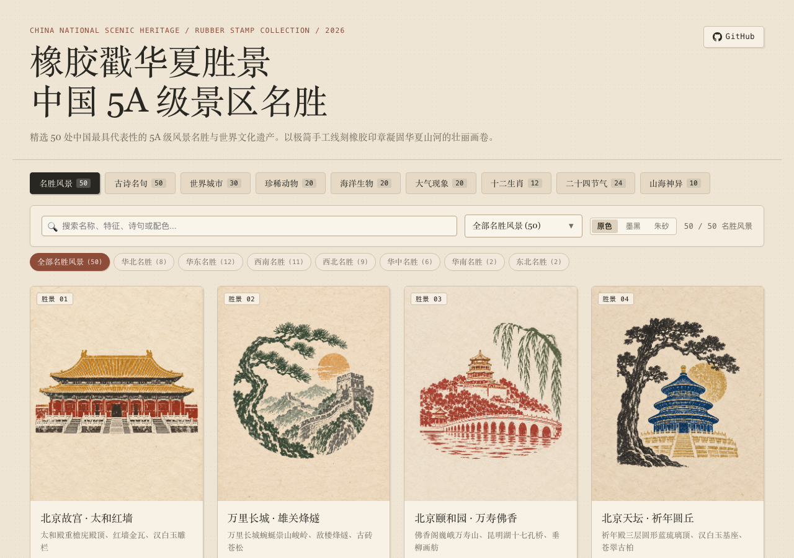

# rubber world 极简橡胶戳艺术印记

复古手工多色橡胶戳印艺术画廊，收录全站 350 枚纯印章艺术作品，分 13 个系列：名胜风景 50 枚、古诗名句 50 枚、世界城市 30 枚、中国城市 30 枚、时令节日 20 枚、热门胜地 24 枚、游戏神作 40 枚、珍稀动物 20 枚、海洋生物 20 枚、大气现象 20 枚、十二生肖 12 枚、二十四节气 24 枚、山海神异 10 枚。画面剥离文字与排版干扰，保留纯粹版画雕刻图章主体与米白纤维纸张质感。

## 功能

- **浏览与筛选**：按 13 个系列切换，点图片看大图，左右滑动或点箭头翻页。
- **搜索**：输入名胜、诗句、城市、动物等关键词，全站搜索。
- **点赞收藏**：点爱心收藏喜欢的作品，收藏存在浏览器本地。
- **批量下载**：点赞后点顶栏「下载」，把收藏的原图打包成 ZIP 一次下载。
- **作图提示词**：每枚作品详情页附原始作图提示词，点一下复制。
- **分享海报**：生成带二维码的分享海报，扫码直达这枚作品。
- **AI 生图 Skill**：内置橡皮图章生成器技能，见下方。

## 在线体验

- Cloudflare 线上站点：<https://rubber-stamp-world-cities.xiaosang.cc/>
- GitHub Pages 演示：<https://holynova.github.io/rubber-stamp/>
- GitHub 源码仓库：<https://github.com/holynova/rubber-stamp>



### 手机扫码体验

手机扫描二维码访问画廊：


## 收录系列

1. **名胜风景（50 幅）**：中国 50 大 5A 级景区与世界遗产胜景（故宫、长城、颐和园、天坛、兵马俑、西湖、黄山、九寨沟、漓江、张家界、莫高窟、泰山、华山、丽江/玉龙雪山、大熊猫基地、拙政园、乌镇、黄鹤楼、大雁塔、三峡、乐山大佛、峨眉山、龙门石窟、普陀山、鼓浪屿、稻城亚丁、布达拉宫、青海湖、三亚亚龙湾、庐山、武夷山、避暑山庄、宏村、平遥古城、云冈石窟、喀纳斯、天山天池、长白山天池、壶口瀑布、黄果树瀑布、荔波小七孔、凤凰古城、中山陵、大足石刻、少林寺、嘉峪关、纳木错、沙坡头、雁荡山、呼伦贝尔草原），涵盖华北、华东、西南、西北、华中、华南、东北七大地理分区。
2. **古诗名句（50 幅）**：50 句极具画面感的中国经典古诗词（竹外桃花三两枝、独钓寒江雪、大漠孤烟直、轻舟已过万重山、一蓑烟雨任平生等），五大辑分类（春生·花木、夏盛·清荷、秋思·枫江、冬藏·飞雪、天地·旷野），图章正下方铭刻千古名句。
3. **世界城市（30 幅）**：精选 30 座全球名城地标、天际线与旅行手账印记。
4. **中国城市（30 幅）**：精选 30 座中国最具代表性的直辖市、新一线与核心大城市（北京、上海、广州、深圳、成都、重庆、杭州、南京、武汉、西安、苏州、天津、长沙、郑州、青岛、宁波、厦门、昆明、大连、沈阳、济南、合肥、福州、哈尔滨、长春、南昌、贵阳、南宁、海口、兰州），以极简 4:5 宣纸刻版印章凝固华夏名城独特的天际线与文脉印记。
5. **时令节日（20 幅）**：春节、元宵节、清明节、端午节、七夕节、中秋节、重阳节、冬至、腊八节、除夕、元旦、劳动节、儿童节、教师节、国庆节、中元节、万圣节、圣诞节、情人节、母亲节，涵盖传统节日与现代节日的节庆印章。
6. **热门胜地（24 幅）**：九寨沟、张家界、丽江古城、布达拉宫、西湖断桥、桂林山水、敦煌莫高窟、黄山迎客松、三亚亚龙湾、稻城亚丁、宏村月沼、喀纳斯湖等国内 12 处热门目的地，以及富士山、伏见稻荷大社、浅草寺雷门、奈良若草山、曼谷大皇宫、普吉岛攀牙湾、清迈塔佩门、芭提雅真理寺、滨海湾花园、巴厘岛海神庙、马尔代夫水屋、吉萨金字塔等海外 12 处。
7. **游戏神作（40 幅）**：8 款全球顶流现象级游戏、40 组标志性主角与经典场景交融的版画印章。
8. **珍稀动物（20 幅）**：大熊猫、金丝猴、雪豹、朱鹮等 20 种珍稀物种与大自然生灵。
9. **海洋生物（20 幅）**：蓝鲸、虎鲸、蝠鲼、海龟等 20 尊深海巨灵与蔚蓝生灵。
10. **大气现象（20 幅）**：极光、双彩虹、日全食、龙卷风、晚霞等 20 种自然天象奇观。
11. **十二生肖（12 幅）**：子鼠、丑牛、寅虎、卯兔、辰龙、巳蛇、午马、未羊、申猴、酉鸡、戌狗、亥猪瑞兽印记。
12. **二十四节气（24 幅）**：春生、夏长、秋收、冬藏，24 幅物候印章。
13. **山海神异（10 幅）**：九尾狐、烛九阴、帝江、白泽、毕方、鲲鹏、饕餮、穷奇、陆吾、夫诸等 10 尊神异版画。

## AI 生图 Agent Skill（橡皮图章生成器）

项目现已内置并开源专业的 Agent 技能包：[`rubber-stamp-art`](./skills/rubber-stamp-art/SKILL.md)。

沉淀自全站 350 枚图章的提示词规律与版画构图法则，支持**文字输入**（诗词、地标、概念自动生成图章 Prompt）与**图片输入**（用户上传照片/线稿，智能剥离背景杂质转为刻版线条印章）双模式。

### 安装命令

```bash
npx skills add holynova/hn-codex-skills --skill rubber-stamp-art
```

- 查看技能文档：[`skills/rubber-stamp-art/SKILL.md`](./skills/rubber-stamp-art/SKILL.md)
- GitHub 技能源仓库：[hn-codex-skills](https://github.com/holynova/hn-codex-skills)

## 本地运行

```bash
npm run dev
# 或
npm run serve
```
