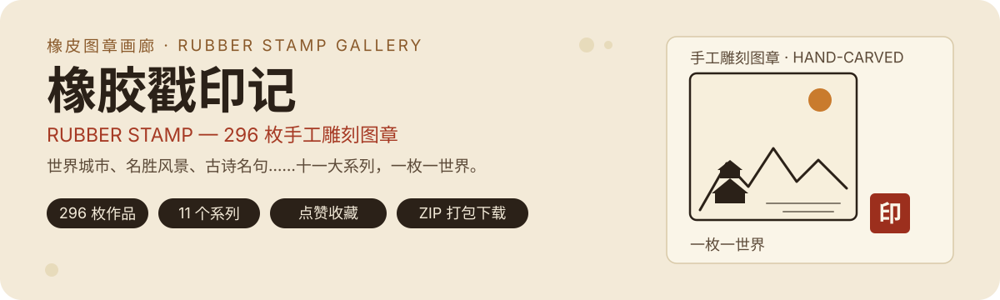

<p align="center">
  
</p>

<p align="center">
  <a href="https://xiaosang.cc/rubber-stamp-world-cities/">▶ 在线体验 Online Demo</a>
  ·
  <a href="https://holynova.github.io/rubber-stamp/">GitHub Pages 镜像</a>
  ·
  <a href="https://github.com/holynova/rubber-stamp">GitHub 仓库</a>
</p>

橡胶戳印记是一座手工多色橡胶戳印艺术画廊：296 枚作品，11 个系列。画面剥离文字与排版干扰，只保留纯粹的版画雕刻图章主体与米白纤维纸张质感——世界城市、名胜风景、古诗名句、十二生肖、二十四节气、山海神异，一枚一世界。

Rubber Stamp is a gallery of hand-carved multi-color rubber stamp art: 296 works in 11 series. Each piece strips away text and layout noise, keeping only the carved stamp and warm fibrous paper — world cities, scenic spots, classical poetry, zodiac animals, solar terms, and mythical beasts from the Classic of Mountains and Seas.

> **分支说明**：本 README 描述默认分支 `main`（296 枚）。`main` 与 `master`（350 枚）已分叉，线上部署的是 `master`（多了中国城市 30、时令节日 20、热门胜地 24，少了古建名山 20），在线体验看到的系列与数量与本分支略有不同。仓库曾用名 `rubber-stamp-world-cities`，现已改名 `rubber-stamp`；旧 Pages 地址已 404，请用新地址。

## 截图 / Screenshots

<p align="center">
  
</p>

> 截图为当前 `main` 分支本地实拍。仓库根目录的 `screenshot.png` 与 `screenshot_journal.png` 是旧版本截图（后者显示 236 枚），保留未删。

## 收录系列 / Collections

| # | 系列 | 数量 | 内容 |
|---|------|------|------|
| 1 | 名胜风景 | 50 | 中国 50 大 5A 级景区与世界遗产（故宫、长城、颐和园、天坛、兵马俑、西湖、黄山、九寨沟……），分华北、华东、西南、西北、华中、华南、东北七大地理分区 |
| 2 | 古诗名句 | 50 | 50 句极具画面感的经典古诗词，分春生·花木、夏盛·清荷、秋思·枫江、冬藏·飞雪、天地·旷野五辑，图章下方铭刻名句、出处与作者 |
| 3 | 世界城市 | 30 | 30 座全球名城地标与天际线（上海、北京、东京、京都、巴黎……） |
| 4 | 珍稀动物 | 20 | 大熊猫、金丝猴、雪豹、朱鹮等野生动物 |
| 5 | 海洋生物 | 20 | 蓝鲸、虎鲸、蝠鲼、水母、鹦鹉螺等海洋生灵 |
| 6 | 大气现象 | 20 | 极光、双彩虹、日全食、龙卷风、海市蜃楼、丁达尔光等天象奇观 |
| 7 | 十二生肖 | 12 | 子鼠至亥猪瑞兽印记 |
| 8 | 二十四节气 | 24 | 春生、夏长、秋收、冬藏，24 幅物候印章 |
| 9 | 山海神异 | 10 | 九尾狐、烛九阴、帝江、白泽、毕方、鲲鹏、饕餮、穷奇、陆吾、夫诸 |
| 10 | 游戏神作 | 40 | 8 款游戏各 5 景：黑神话、艾尔登法环、塞尔达传说、荒野大镖客、原神、巫师 3、赛博朋克、最终幻想 7 |
| 11 | 古建名山 | 20 | 中国古建筑 10（故宫太和殿、悬空寺、应县木塔、赵州桥……）与世界名山 10（珠峰、富士山、马特洪峰……） |

数量按 `data.js` 实数（296 枚），与各系列声明一致。

## 功能 / Features

- **系列切换与搜索**：11 个系列一键切换；按名称、特征、诗句或配色搜索。
- **详情弹窗**：点开任意图章看高清大图，左右滑动切换上一张 / 下一张，可一键复制该图的作图提示词。
- **点赞收藏**：点 ♥ 收藏到「我的点赞」，存在浏览器本地，刷新不丢。
- **批量打包下载**：一键把全部已点赞图章打包成 ZIP 下载（JSZip 本地打包）。
- **分享卡片**：任意图章生成分享卡片，带二维码与系列标签，可导出分享海报。
- **沉浸模式**：隐藏界面元素，只看图章本身。
- **无限滚动**：画廊按需分批加载，配 400×500 缩略图与详情 webp 两级图片。

## 本地运行 / Run Locally

```bash
npm run dev     # python3 -m http.server 8080
# 或
npm run serve   # npx serve .
```

注意：仓库约 2.2GB（含 962 张图片），克隆需要较长时间与磁盘空间。

## 技术 / Tech

- 纯静态站，零构建：`index.html`（约 90KB，全部界面与逻辑）+ `data.js`（571KB，`window.COLLECTIONS` 数据集，11 系列 × 296 条记录，每条含名称、特征、关键词、配色、作图提示词与图片路径）。
- 两级图片：`images/thumbnails/`（400×500 webp，列表用）与 `images/detail_webp/`（详情用），由 `scripts/generate_thumbnails.js` / `generate_detail_webp.js` 生成；原图在 `images/` 各系列目录。
- 各系列作图提示词保存在 `prompts*.json`（另有 `prompts.txt` 合集与 `source_prompt.md` 原文提示词）；`build_data.py` / `generate_series.py` 等脚本用于批量生成与整理数据。
- 依赖只有 JSZip（打包下载）与 qrcode（分享卡二维码），均为单文件引入。

```
index.html              入口：画廊、搜索、详情弹窗、点赞、分享、打包下载
data.js                 数据集：window.COLLECTIONS（11 系列，296 条）
images/                 962 张图片：原图 + thumbnails + detail_webp
prompts*.json           各系列作图提示词
scripts/                缩略图 / 详情 webp 生成、数据同步、性能测量
build_data.py           数据集生成脚本
generate_*.py           批量生成脚本（批次 / 诗句 / 系列）
```

## English

**Rubber Stamp** is a gallery of hand-carved multi-color rubber stamp art — 296 works in 11 series, each a minimalist carved stamp on warm fibrous paper.

- **Collections** (counts verified against `data.js`): 5A scenic spots (50), classical poetry lines (50), world cities (30), rare wildlife (20), marine life (20), atmospheric phenomena (20), zodiac animals (12), solar terms (24), Classic of Mountains and Seas beasts (10), legendary games (40 — 8 games × 5 scenes: Black Myth, Elden Ring, Zelda, Red Dead Redemption, Genshin Impact, The Witcher 3, Cyberpunk, Final Fantasy VII), heritage architecture & famous mountains (20).
- **Features**: series switching, search by name/feature/verse/color, detail modal with swipe navigation and one-click prompt copy, likes saved in local storage, batch ZIP download of liked stamps (JSZip, done locally), share cards with QR code and poster export, immersive mode, infinite scroll with two-tier images (400×500 thumbnails + detail webp).
- **Branch note**: this README describes the default branch `main` (296 works). `main` and `master` (350 works) have diverged; the live site serves `master` (adds Chinese cities, seasonal festivals, and popular destinations; drops heritage mountains), so the live gallery differs slightly from this branch. The repository was renamed from `rubber-stamp-world-cities` to `rubber-stamp`.
- **Run it**: `npm run dev` (Python http.server on 8080) or `npm run serve`. Note the repo is ~2.2GB (962 images).
- **Tech**: pure static site, no build — `index.html` plus `data.js` (`window.COLLECTIONS`, 296 records with names, features, keywords, colors, generation prompts, and image paths). Only dependencies are single-file JSZip and qrcode.

## 许可 / License

MIT（见 `package.json`；仓库内暂无 LICENSE 文件）。
